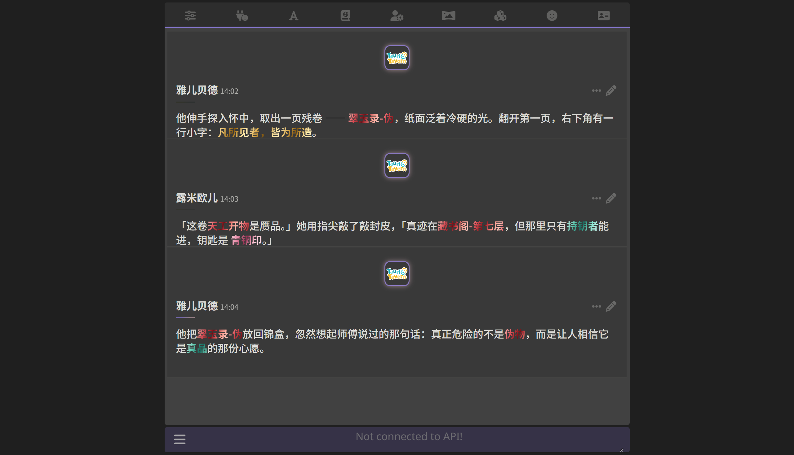

# 金属括号强调 (Metal Brackets)

把正文里的 `【内容】` 渲染成金属渐变强调文字，符号本身默认隐藏。

字重和颜色已经足够表达强调，留着符号反而多一层噪声 —— 但要不要显示、显示哪个符号、每种符号什么颜色，全都能在扩展设置里改。



## 依赖

- **TauriTavern 1.13.0+**

依赖 TauriTavern 在 `scripts/message-formatter.js` 提供的 `MessageFormatter` 钩子系统，原生 SillyTavern 没有这套 API，装了也不会生效。

## 安装

把整个目录放进：

```
<TauriTavern 数据目录>/extensions/third-party/tauritavern-metal-brackets/
```

例如 `F:\AITools\Chat\TauriTavern\TTdata\extensions\third-party\`。

重启 TauriTavern（或在扩展面板里重载）。控制台出现这行就说明挂上了：

```
[MetalBrackets] 已挂载 | 规则 1 组 | 样式 4 套 | 启用=true
```

## 功能

### 符号规则

任意组「开符号 / 闭符号 / 样式」组合，默认内置 `【】`。支持多字符符号（`[[` `]]`），也支持同时启用多组：

| 符号 | 样式 |
|---|---|
| `【】` | 朱砂 |
| `《》` | 青玉 |
| `『』` | 暗金 |
| `[[]]` | 玫瑰金 |

开符号长的优先匹配，所以 `[[` 不会被 `[` 抢走。

### 样式参数

| 参数 | 范围 | 说明 |
|---|---|---|
| 渐变角度 | 0–180° | 115° 是斜向扫描，90° 是竖向圆柱（比较土） |
| 扫描周期 | 1–8em | 一个完整明暗循环的宽度。**低于 1.5em 会碎成噪点**，高于 6em 长句会退化成平滑过渡 |
| 字重 | 300–800 | 600 是默认 |
| 长度上限 | 10–120 | 超长的符号内容不处理，避免整段被吞 |
| 显示括号 | 开/关 | 关闭时括号保留在 DOM 里，只是 CSS 隐藏 |

### 色板

每套样式 6 个色标，顺序是 **亮 → 主 → 暗 → 最暗 → 次亮 → 高光**，然后自动回到第一个颜色闭合循环。这个明暗节奏就是金属反光的来源 —— 全亮像荧光笔，全暗融进深色背景。

内置四套：朱砂、青玉、暗金、玫瑰金。每个色标都能在设置面板里直接改。

### 生效方式

| 改了 | 生效 |
|---|---|
| 颜色 / 角度 / 周期 / 字重 / 长度上限 / 括号显隐 | **立即**，重新生成样式表，零重渲染 |
| 符号规则 / 启用开关 | `reloadCurrentChat()` 重渲染整个聊天 |

## 为什么不用「正则」扩展

SillyTavern 的正则扩展跑在 `converter.makeHtml()` **之前**（`script.js:2568`），拿到的还是纯文本，**分不清代码块边界**。

如果正文里有：

````
```
【道具】的合成配方
```
````

正则会把里面的 `【道具】` 也替换成 `<span>`，然后 markdown 把整块当代码转义，页面上就会直接显示 `<span>` 字面量。

SillyTavern 自己的引号处理正则都显式写了 `` ```...``` `` 排除，就是为了绕这个坑。

本扩展改用 `afterMarkdown` 阶段（`script.js:2656`，markdown 转换之后、DOMPurify 之前），拿到的已经是 HTML，用同步 `DOMParser` 遍历文本节点，遇到 `<code>` / `<pre>` / `<script>` / `<style>` 直接跳过，只处理真正的正文。

## 匹配规则

- 内容不跨行
- 内容里不能再出现任何一个已配置的开/闭符号（避免 `【a《b》c】` 这种跨嵌套错位）
- 必须成对闭合
- 幂等：处理过的元素带 `data-tt-metal` 属性，`closest()` 会跳过它

**已知不处理**：`【<strong>强调</strong>道具】` 这种符号和被包内容跨了 HTML 标签的情况 —— `【` 和 `】` 落在不同文本节点里，逐节点扫描看不到完整的一对。正常写作里极少出现。

## ⚠️ 四个坑

都是调试时实际撞到过的，改代码之前先看这个。

### 1. class 会被 SillyTavern 加上 `custom-` 前缀

`scripts/chats.js:1918` 的 `uponSanitizeAttribute` 钩子：

```js
case 'class': {
    data.attrValue = data.attrValue.split(' ').map((v) => {
        if (v.startsWith('fa-') || v.startsWith('note-') || v === 'monospace') return v;
        return 'custom-' + v;      // ← tt-metal 变成 custom-tt-metal
    }).join(' ');
}
```

`afterMarkdown` 钩子跑在 `DOMPurify.sanitize()` **之前**，所以 JS 里写下的 `class="tt-metal"` 到了 DOM 里会变成 `class="custom-tt-metal"`，CSS 选择器全部落空。

症状很有迷惑性：**符号消失了但颜色没变** —— 文本已经被改写（钩子生效了），只是样式没命中。

**解法**：用 `data-*` 属性做选择器。`uponSanitizeAttribute` 只处理 `class`，`data-*` 走 DOMPurify 默认规则（`ALLOW_DATA_ATTR: true`），不会被改。

### 2. 必须写 `background-image`，不能用 `background` 简写

```css
/* 错的：background 简写会把 background-clip 重置回 border-box */
background: linear-gradient(...);
-webkit-background-clip: text;

/* 对的 */
background-image: linear-gradient(...);
-webkit-background-clip: text;
```

写成简写的结果是整段文字变成一块彩色矩形。

### 3. 必须显式 `text-shadow: none`

很多主题（比如常见的「双色盒子」）用 `shadow_width: 0` 表达「无阴影」，实际生成的是：

```css
text-shadow: rgb(34, 34, 34) 0px 0px 0px;
```

这是在字形同一位置盖一层模糊半径为 0 的**实心暗色**。渲染顺序是「背景 → text-shadow → 文字填充」，而 `background-clip: text` 用的是背景层，会被这层实心投影整个压暗 —— 所有渐变都变成一片深灰。

### 4. 流式渲染会换容器

JS-Slash-Runner 流式输出时给 `.mes_text` 加 `display: none !important`，另外插入一个 `<div class="TH-streaming">`。任何挂在 `.mes_text` 上的规则在流式期间会全部失效。

**解法**：选择器不绑定容器。本扩展全部用 `[data-tt-metal]` 属性选择器，与容器无关，`.mes_text` 和 `.TH-streaming` 里都能生效。

## 性能

| 场景 | 耗时 |
|---|---|
| 不含符号的消息（`includes` 短路） | 0.0001 ms |
| 含 3 处符号的消息 | 0.033 ms |
| 300 条消息全量重渲染 | 2.1 ms |

一帧是 16.7ms，全量重渲染只占 1/8 帧。日常聊天每次只处理 1 条新消息。

## 目录

```
manifest.json     入口声明
index.js          全部逻辑（配置 / 匹配 / 样式生成 / 设置面板）
README.md
LICENSE
docs/preview.png
```

样式全部由 JS 按配置生成，没有独立的 css 文件。

## 许可

MIT
